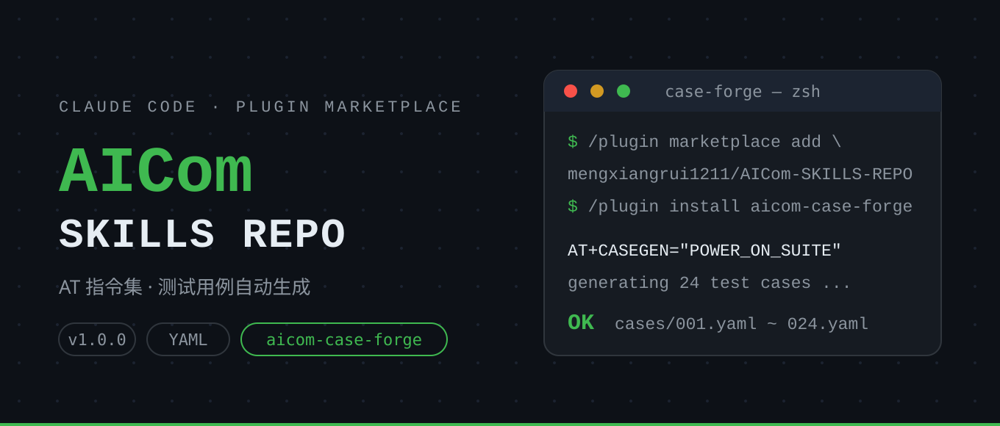

<p align="center">
  
</p>

# AICom SKILLS REPO

AICom 技能知识仓库：Claude Code plugin marketplace 结构，由 AICom 发布维护。

## 安装

```bash
/plugin marketplace add mengxiangrui1211/AICom-SKILLS-REPO
/plugin install aicom-case-forge@AICom-SKILLS-REPO
```

## 技能列表

| 技能 | 版本 | 说明 |
|------|------|------|
| [aicom-case-forge](plugins/aicom-case-forge) | v1.0.0 | 按 AT 指令集批量生成符合引擎规范的 YAML 测试用例 |
